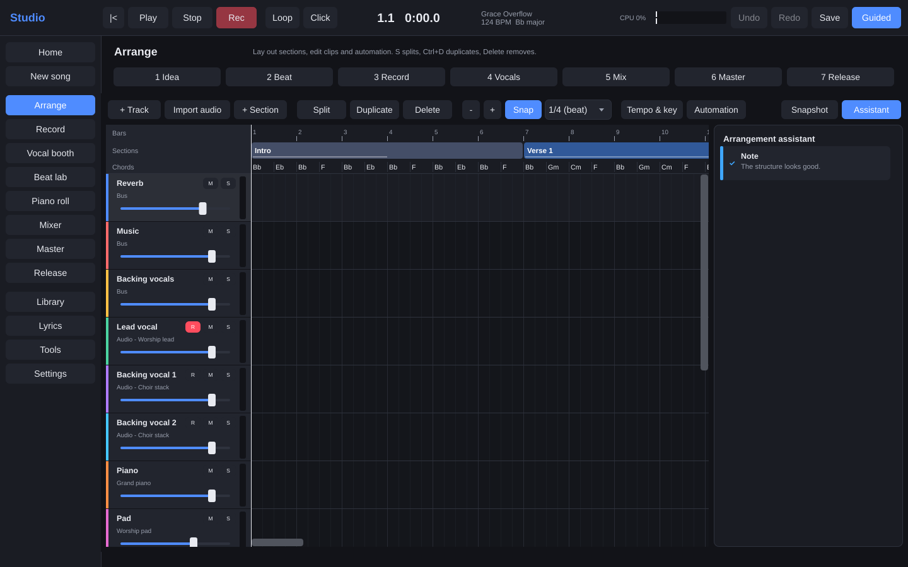
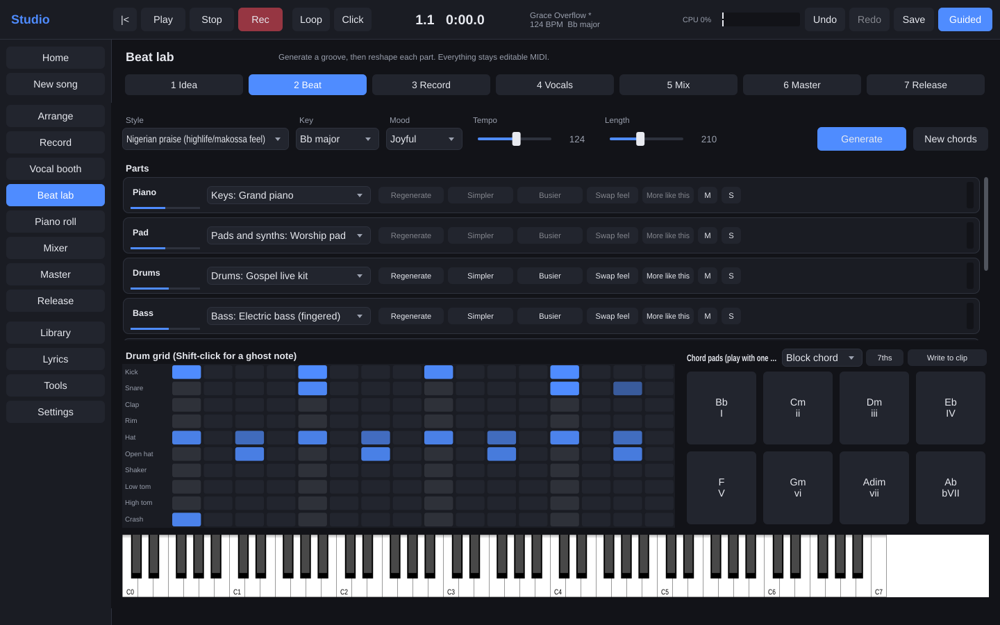
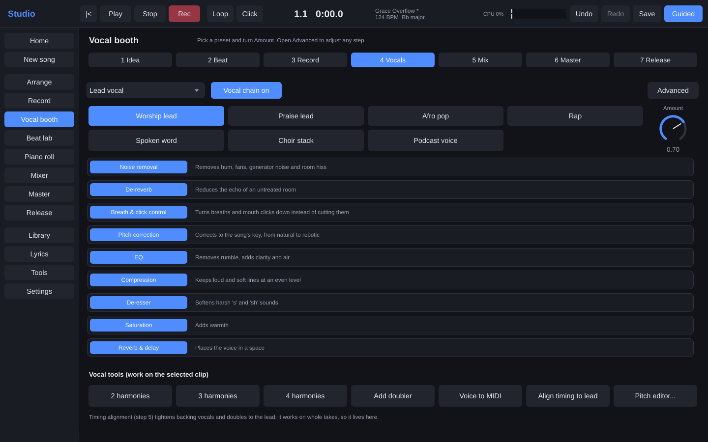
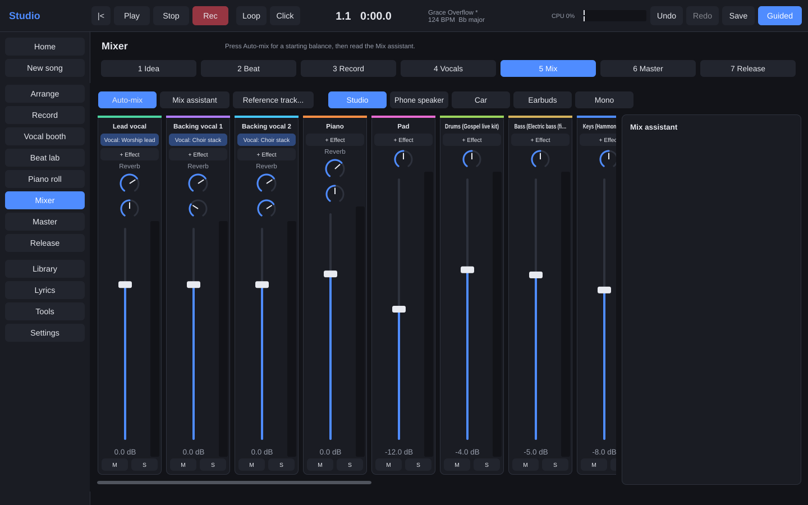
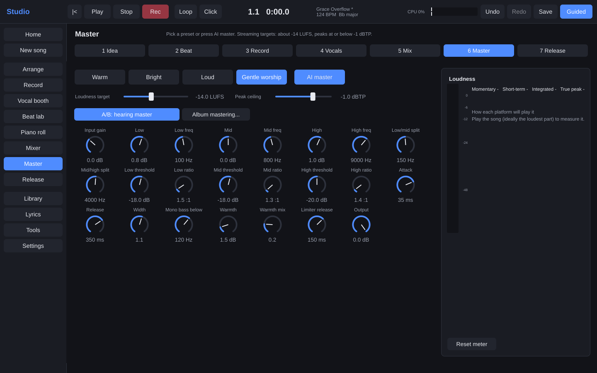

# Studio

A full home studio in one desktop app. It is built for gospel, Afro and worship artists recording at home with one microphone. You can record a clean vocal, generate a full band in your style, mix, master to streaming standards, and package the release for distributors.

It is a native C++ app built on [JUCE](https://juce.com). Recording, beats, mixing, mastering and export all work offline.



| Beat lab | Vocal booth |
| --- | --- |
|  |  |
| **Mixer** | **Master** |
|  |  |

## What's in it

- **Record**: input setup wizard, room check (noise floor, hum and hiss, with fixes), low-latency monitoring with headphone-only reverb, count-in, pre-roll, punch in/out, loop recording into takes, comping with crossfades, and multi-input recording.
- **Vocal chain** (10 steps, each can be bypassed): noise removal, de-reverb, breath and click control, pitch correction (natural to robotic, plus a note editor), timing alignment, EQ, compression, de-esser, saturation, and reverb/delay sends.
  - Presets: Worship lead, Praise lead, Afro pop, Rap, Spoken word, Choir stack and Podcast voice, each with one Amount knob.
  - Extra tools: harmony generator (2–4 parts, in key), doubler, voice-to-MIDI and stem separation.
- **Beat generator**: pick a style, tempo, key, mood and length. It writes a chord progression plus drums, bass, keys, guitar, percussion and pads, each as editable MIDI on its own track.
  - Per-part controls: Regenerate, Simpler, Busier, Swap feel and More like this.
  - Nine styles: worship ballad, contemporary worship, Nigerian praise, Afrobeats, amapiano, highlife, gospel R&B, hip hop/trap and reggae/dancehall.
- **Instruments**: 43 starter instruments across every family in the spec, including the Hammond with Leslie, talking drum, shekere, conga, djembe, udu, agogo, log drum and choir. A streaming sampler plays multi-sampled packs from disk.
- **Arrange**: song sections you can duplicate, reorder and resize, with every track following.
  - Vamp builder with a key lift.
  - Arrangement assistant: suggests a structure and flags sections that drag.
  - Tempo and key track, markers, comments pinned to the timeline, automation, and unlimited undo with named snapshots.
- **Piano roll**: velocity lane, scale highlighting, smart quantize, humanize and chord detection. The Beat lab adds a drum grid, chord pads, strum/arpeggio and an on-screen keyboard; MIDI keyboards work without setup.
- **Mixer**: buses and sends, plus 16 built-in effects, sidechain ducking, and VST3/AU plugin hosting.
  - Auto-mix by track role.
  - Mix assistant: problems in plain words with one-click fixes.
  - Reference-track comparison and listening checks (phone, car, earbuds, mono).
- **Master**: EQ, 3-band compression, imaging, saturation and a true-peak limiter.
  - Presets: Warm, Bright, Loud and Gentle worship.
  - An AI master that explains its choices, an EBU R128 loudness meter, per-platform turn-up/down, a level-matched A/B, and album mastering.
- **Export**: 24-bit WAV (44.1/48 kHz), FLAC, MP3 320, AAC, instrumental, a cappella, stems per bus, a performance track with click and cues, MIDI, and a lyric video (MP4).
- **Release desk**: metadata with validation (ISRC, UPC, names, dates), splits, lyrics with tap-to-sync (LRC), and a 3000×3000 cover checker plus art maker.
  - Pre-release checklist covering loudness, clipping, silence, metadata and artwork.
  - Export package for manual upload to DistroKid, TuneCore, Amuse or CD Baby.
  - Smart-link and pre-save page generator, earnings CSV import, and reminders to register with COSON and a publisher.
- **Everything else**:
  - Lyrics pad with syllable counts, a rhyme helper, a chord chart and voice memos.
  - Tuner, metronome with tap tempo, and key/tempo and chord-from-audio detectors.
  - Autosave every 30 s with crash recovery, and a sync manifest with content hashes.
  - Four templates, guided mode with lessons, keyboard shortcuts, and a dark, colour-blind-safe UI.

See **[docs/SPEC_COVERAGE.md](docs/SPEC_COVERAGE.md)** for a line-by-line map against the product spec, including what is not built yet.

## Build

You need CMake 3.22+, a C++20 compiler, and Git. JUCE 8.0.9 is downloaded automatically. Pass `-DSTUDIO_JUCE_DIR=/path/to/JUCE` to use a local checkout instead.

```bash
cmake -S . -B build -DCMAKE_BUILD_TYPE=Release
cmake --build build --parallel
```

The outputs are:

- `build/source/app/studio_app_artefacts/Release/Studio`: the desktop app (`Studio.app` on macOS, `Studio.exe` on Windows)
- `build/source/cli/studio_cli_artefacts/Release/studio_cli`: the command-line tool
- `build/tests/studio_tests_artefacts/Release/studio_tests`: the unit tests

**Linux packages (Ubuntu/Debian):**

```bash
sudo apt-get install libasound2-dev libfreetype-dev libfontconfig1-dev libx11-dev libxrandr-dev \
  libxinerama-dev libxcursor-dev libxext-dev libgl-dev libcurl4-openssl-dev libsqlite3-dev
```

**Windows, ASIO:** to monitor under 10 ms with ASIO drivers, download the Steinberg ASIO SDK (it cannot be redistributed) and configure with `-DSTUDIO_ASIO_SDK_DIR=C:/path/to/asiosdk`. Without it, Studio uses WASAPI and DirectSound.

**Encoders:** MP3, AAC and lyric video exports need `ffmpeg` (or `lame` for MP3) on the PATH or next to the app. WAV, FLAC and everything else are built in.

**Link-time optimisation** is off by default for fast development builds. Turn it on for releases with `-DSTUDIO_ENABLE_LTO=ON`.

## Command line

`studio_cli` drives the same engine without a UI. It is useful for batch work, CI and testing.

```bash
studio_cli new "Grace.studio" --template "Worship single" --name "Grace"
studio_cli beat "Grace.studio" --style nigerian_praise --key "G major" --mood joyful --length 180
studio_cli automix "Grace.studio"
studio_cli assist "Grace.studio" --fix
studio_cli export "Grace.studio" --stems --performance --video
studio_cli package "Grace.studio"          # upload package + pre-release checklist
studio_cli master mix.wav master.wav --ai --style worship_ballad
studio_cli analyse song.wav                # key, tempo, chords, tone
studio_cli vocal raw.wav clean.wav --preset "Praise lead" --key "Bb major"
studio_cli separate song.wav stems/
studio_cli help
```

## Tests

```bash
./build/tests/studio_tests_artefacts/Release/studio_tests
```

The tests cover:

- **Measurement**: loudness against EBU Tech 3341 (a −23 dBFS stereo 1 kHz tone reads −23.0 LUFS), true peak, and the limiter ceiling.
- **Effects**: EQ, compressor and sidechain, gate, reverb, de-esser, STFT reconstruction, noise removal and hum removal.
- **Pitch**: pitch detection, shifting and correction, harmonies, voice-to-MIDI, and time-stretch.
- **Analysis**: key, tempo and room check.
- **Chains**: every vocal and mastering preset, where mastering must hit −14 LUFS with peaks at or below −1 dBTP.
- **Generator**: every beat-generator style (range, determinism, density and chord tones).
- **Song editing**: arrangement edits, and an end-to-end render that is analysed back to its tempo and key.
- **Rendering**: stems summing back to the mix, and audio clip timing.
- **Release and projects**: release validation, artwork checks, LRC, project save/load, undo, snapshots, crash recovery, sync manifests, comping, the loop library and lyrics tools.

CI (`.github/workflows/ci.yml`) builds on Linux, macOS and Windows. It runs the tests, an end-to-end generate → render → export run, and renders UI screenshots with `Studio --screenshot <dir>`.

## Project format

A song is a self-contained folder, so it can be zipped, moved or synced:

```
My Song.studio/
  project.json   tempo, key, tracks, sections, chords, routing, automation, release metadata
  audio/         recorded and imported audio
  takes/         every recorded take, kept for comping
  midi/ presets/ release/ (metadata.json, artwork, exports) history/ (snapshots)
```

## Documentation

- [docs/ARCHITECTURE.md](docs/ARCHITECTURE.md): engine threading, graph handover, latency compensation, and the DSP and ML slots
- [docs/SPEC_COVERAGE.md](docs/SPEC_COVERAGE.md): every spec item and its status
- [docs/SOUND_PACKS.md](docs/SOUND_PACKS.md): the sample pack format and streaming
